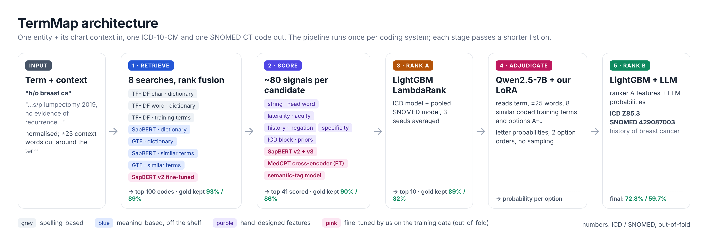

# TermMap: clinical terms → ICD-10-CM + SNOMED CT

**HiLabs AIQuest 2026 · Team Ranger (IIT Madras)**
Naveen Prakash Junodiya (bs23b011@smail.iitm.ac.in) · Neeraj Meena (ch23b099@smail.iitm.ac.in) · Khushwant Meena (bs23b029@smail.iitm.ac.in)

TermMap takes a clinical term and the chart text around it, and returns **one ICD-10-CM code and one SNOMED CT code**.
All models are open-weight and self-hosted, so the data never goes to an external API, and the output is deterministic.

| | ICD-10-CM | SNOMED CT | Headline (min) |
|---|---|---|---|
| All rows (out-of-fold, 9,646 rows) | **72.8%** | **59.7%** | **59.7%** |
| Diagnosis rows | 72.8% | 69.0% | – |
| Codes never seen in training | 53.2% | 48.1% | – |

**Links:** Demo video: [Google Drive](https://drive.google.com/drive/folders/1rqzSmZfYWchnJlvUm92Fw7DQa_G7yinX?usp=sharing) · Write-up PDF: [Google Drive](https://drive.google.com/drive/folders/1ZYZWa0wbLw73pXPmdszH0gVEyzOO28BJ?usp=sharing) (also in [docs/](docs/TermMap_Writeup_TeamRanger.pdf)) · Weights: https://huggingface.co/Naveenmeena/termmap-weights

---

## Quick start

```bash
# 1. install (Python 3.10+, one GPU with ≥16 GB for the full pipeline)
pip install -r requirements.txt

# 2. put the three HiLabs files in data/
#    data/hackathon_train.csv   data/icd.xlsx   data/snomed.xlsx

# 3. download our trained weights from Hugging Face into weights/ (public, no login)
python tools/download_weights.py

# 4. run: one command, evaluation file in, predictions out
python predict.py --input <evaluation.csv> --out predictions.csv
```

**Or everything in one line** (downloads the weights on the first run, then predicts):
```bash
bash run.sh <evaluation.csv> predictions.csv
```
Re-running the same command on the same file gives the same predictions: there is no sampling anywhere.

- **Input:** a CSV with `clinical_entity` (or `entity`) and `chunk_text`, plus optional `chunk_id`. Long format
  (`entity, coding_system`) also works.
- **Output:** `chunk_id, clinical_entity, icd10cm_code, snomed_code`, plus `predictions_debug.csv` with a confidence
  margin for every prediction (low margin = worth a human look).
- **No GPU?** Add `--no-llm`. The pipeline then skips the 7B LLM and returns ranker A's answer (54.9% SNOMED).
- **Other file names?** Use `--train`, `--icd` and `--snomed` to point at them.

Base models (Qwen2.5-7B-Instruct, SapBERT, GTE) download from their official Hugging Face repos on first use.
Embeddings of the training terms are built automatically on the first run (~1 min).

## Environment variables

No API keys are needed. `.env.example` lists optional settings only: `HF_TOKEN` (for a private mirror),
`HF_HOME` (model cache) and `CUDA_VISIBLE_DEVICES`. Copy it to `.env` if you need them. `.env` is git-ignored.

## How it works



1. **Retrieve (top 100):** 8 searches merged by reciprocal-rank fusion: TF-IDF over the dictionaries and over training
   terms, SapBERT + GTE (dictionary and similar training terms), and our fine-tuned SapBERT retriever.
2. **Score (top 41):** about 80 features (string match, laterality / acuity / history / negation, specificity, ICD block
   votes, code priors), plus our fine-tuned SapBERT v2/v3 and fine-tuned MedCPT cross-encoder scores, plus a SNOMED
   semantic-tag classifier.
3. **Ranker A:** LightGBM LambdaRank (an ICD model, and a pooled model for SNOMED), 3 seeds, which produces a top 10.
4. **LLM adjudicator:** Qwen2.5-7B-Instruct with our LoRA reads the term, ±25 words of context and 8 similar coded
   training terms, and gives a probability to each of the 10 options. It is read twice in opposite option orders, with
   no sampling.
5. **Ranker B:** the same features plus the LLM probabilities give the final code and its confidence.

Every neural score the rankers learn from is **out-of-fold** (5-fold GroupKFold by chart chunk), and the LLM's
examples come from other folds only. `tests/test_final_heldout.py` runs a held-out fold through the exact
`predict.py` path: ICD 67.90% vs CV 67.90%, SNOMED 58.49% vs CV 58.56%, with 98.9% identical predictions.

## Repository layout

```
run.sh / predict.py   the single command: evaluation CSV -> predictions CSV
train_final.py        trains the final rankers (models_final/) from the out-of-fold tables
assets.json           where predict.py finds each model inside weights/
termmap/              the engine: data, retrieval, features, neural encoders, LLM, engine_final.py
models_final/         trained LightGBM rankers (stage A + B, 3 seeds) + config
tools/                download_weights.py, build_dict_embeddings.py
kaggle/, llm/         GPU training scripts (retrievers, cross-encoder, LoRA LLM)
experiments/          every experiment behind the results (see experiments/README.md)
tests/                held-out end-to-end test of the predict path
data/                 put the HiLabs files here (not committed, proprietary)
weights/              filled by tools/download_weights.py (not committed)
docs/                 architecture diagram
```

## Results journey (out-of-fold, % exact match)

| Step | ICD | SNOMED |
|---|---|---|
| Lexical TF-IDF top-1 | 42.8 | 36.7 |
| + LightGBM ranker | 51.2 | 42.2 |
| + SapBERT / GTE hybrid search | 63.8 | 50.3 |
| + fine-tuned cross-encoder | 66.4 | 53.7 |
| + fine-tuned retrievers, semantic tag (= ranker A) | 68.3 | 54.9 |
| **+ fine-tuned Qwen2.5-7B adjudicator (final)** | **72.8** | **59.7** |

## Re-training from scratch

| Step | Where | Script |
|---|---|---|
| Dictionary embeddings (public data only) | GPU | `tools/build_dict_embeddings.py` |
| Candidates + features | CPU | `experiments/run_retrieval_cv.py`, `run_dense_candidates.py`, `run_hybrid_cv.py`, `build_v7.py` |
| SapBERT retriever v2 / v3 | Kaggle T4×2 | `kaggle/finetune_bienc.py`, `kaggle/finetune_bienc_v3.py` |
| Cross-encoder v4 | Kaggle T4×2 | `experiments/export_ft_input.py --tag --width 25`, `kaggle/finetune_ce_v4.py` |
| LLM LoRA (5 folds + full) | 1× RTX 4090 | `experiments/export_llm_input.py`, `llm/finetune_llm_lora.py` |
| Out-of-fold experiments | CPU | `experiments/run_fast.py <variant> --base v7 --seeds 3` |
| Final rankers | CPU | `python train_final.py` |

Total about 10–12 GPU-hours. Prediction with the released weights: under 1 s per term on one RTX 4090.

## Determinism, cost and data handling

- **Deterministic:** no sampling anywhere. The LLM is read as letter probabilities, ties break by code string, LightGBM
  runs with `deterministic=True`, and all seeds are fixed.
- **Cost per term:** two 7B forward passes plus small encoders, ≈ ₹0.02 per term on a rented RTX 4090, with no API cost.
- **Data:** the HiLabs training data is proprietary. It is not in this repo or on Hugging Face, and it was used only in
  private environments.

## External resources

- SapBERT (`cambridgeltl/SapBERT-from-PubMedBERT-fulltext`)
- GTE-base (`thenlper/gte-base`)
- MedCPT Cross-Encoder (`ncbi/MedCPT-Cross-Encoder`)
- Qwen2.5-7B-Instruct (Apache-2.0)
- LightGBM, scikit-learn, transformers, PEFT, sentence-transformers, rapidfuzz
- Ontologies: the ICD-10-CM and SNOMED CT US code files provided by HiLabs. No crosswalk, UMLS or other external dataset was used.
